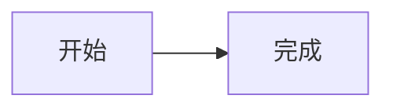

# Folio · 文件工作区

轻量、自托管、浏览器优先的 Markdown 与开发文件工作区。真实文件是正文唯一权威；React + TypeScript + Vite、Milkdown Crepe、CodeMirror 6、Go，嵌入式 SQLite 仅保存账号/会话及可重建索引。

支持文件/目录整理、Markdown 与源码编辑、条件自动保存及冲突副本、附件上传/预览/下载、中英文搜索、快开、回收恢复、本机草稿和移动端抽屉。界面与项目说明统一使用简体中文。

M0–M3 的历史验收及镜像证据可从 Git 历史查阅；旧镜像结果不能替代新构建验证。

## 本地运行

需要 Node.js 22.12+、npm、Go 1.27+、Python 3。以下使用 Make，Windows 可直接执行等效 PowerShell 命令。

```sh
make install
make run
```

打开 <http://127.0.0.1:8080>，账号 admin。首次自动初始化的密码在 app-data/initial-password；已有账号不会因更换引导密码文件而重置。make build 构建并嵌入前端，输出 bin/folio。

开发时在两个终端分别运行 make api 和 make dev，访问 <http://127.0.0.1:5173>，/api 代理到 8080。make run/api 使用回环 HTTP 与非 Secure Cookie；直接启动程序默认使用 Secure Cookie，正式部署须 HTTPS。容器编排见 compose.yaml 与 deploy/compose.proxy.yaml，镜像构建见 Dockerfile。

首次初始化的 admin 是管理员，可在左下角进入 `/system-setting` 创建和管理用户；每个用户拥有独立工作区，默认配额 5 GB。管理员可改名、启用/禁用、调整配额和重置密码。开发阶段旧单账号数据不迁移，需停服后清理两数据目录重新初始化。

## 数据与配置

| 环境变量 | 默认值或用途 |
| --- | --- |
| FOLIO_WORKSPACE | ./workspace，各用户工作区的根目录，正文与附件在 <用户ID>/ 下 |
| FOLIO_APP_DATA | ./app-data，账号、会话、各用户索引与回收站 |
| FOLIO_ADDR | 监听地址；本地默认 127.0.0.1:8080 |
| FOLIO_PASSWORD_FILE | 仅首次初始化用的私有普通密码文件 |
| FOLIO_SECURE_COOKIE | true；false 仅允许回环 IP |
| FOLIO_TLS_CERT / FOLIO_TLS_KEY | 直接 HTTPS 证书链与私钥，须同时设置 |
| FOLIO_ORIGIN | 代理后的精确外部来源，如 https://notes.example.com |
| FOLIO_MAX_TEXT_BYTES | 5 MiB，文本编辑上限 |
| FOLIO_MAX_IMAGE_BYTES | 20 MiB，图片上限 |
| FOLIO_MAX_PDF_BYTES | 50 MiB，PDF 上限 |
| FOLIO_MAX_ATTACHMENT_BYTES | 100 MiB，其他附件上限 |
| FOLIO_MAX_IMAGE_PIXELS | 3200 万像素，图片预览上限 |
| FOLIO_MAX_INDEX_BYTES | 5 MiB，正文索引上限；可设 1 字节至 100 MiB |

配置只在启动读取，GET /api/v1/settings 返回文件限制，上传总上限最大 1 GiB。workspace 与 app-data 必须独立、不能相互包含，只支持单实例写工作区。运行用户和目录权限/ACL 由部署者保护，不应与外部工具同时写同一文件。

Ctrl/Cmd+P 或 Ctrl/Cmd+Shift+F 打开统一搜索，其余快捷键见应用帮助。超限或二进制仅索引名称。PDF 复杂字体/大图等以下载原件核对；SVG/HTML 不活动预览。升级/关闭前保存或下载草稿及待上传原件，本机缓存不是备份。

## 验证

```sh
make test
make qa
```

浏览器默认 /usr/bin/google-chrome，其他路径通过 CHROME_BIN 指定。容器镜像需另运行 make container-test 与 make container-review。方法、平台差异和未验证范围见 [测试计划](docs/TESTPLAN.md)，本次执行不能沿用历史测试计数。

## 文档导航

| 文档 | 维护内容 |
| --- | --- |
| [产品规范](docs/SPEC.md) | 产品边界、技术选择与行为要求 |
| [视觉与交互](docs/DESIGN.md) | 主题、布局、交互与无障碍设计 |
| [架构说明](docs/ARCHITECTURE.md) | 模块、数据流、文件与恢复机制 |
| [接口协议](docs/API.md) | 已实现路由、字段、错误与并发协议 |
| [路线图](docs/ROADMAP.md) | 阶段范围、完成标准与待验证环境 |
| [测试计划](docs/TESTPLAN.md) | 验证命令、覆盖矩阵及证据要求 |
| [代理约定](AGENTS.md) | 实现与交付必须遵守的规则 |

搜索索引由文件 API 变更异步更新，无定时工作区扫描或系统文件监听。直接修改宿主目录后，请在搜索窗口重建索引，或重启服务后访问工作区；启动重建同时补偿未完成的索引事件。打开文档的版本探测与 ETag 保存保护仍保留。


## 系统设置与状态（2026-10-17）

管理员可在 /system-setting 的“系统设置”在线调整文本、图片、PDF、附件、像素和正文索引限制。首次读取环境变量初始值，保存后 app.db 持久值优先，重启保留；索引上限变化自动重建。降低限制不会清理文件，但已有超限文本可能需恢复上限后编辑，原文件仍可下载。“系统状态”显示运行时指标，磁盘目录用量按需统计。


## Mermaid 图表

Markdown 富文本可直接预览标准 Mermaid 围栏，也可从代码块语言菜单选择 mermaid；代码与图表可切换显示。源码模式保留原始文本。例如：

````markdown

````

渲染失败会就地提示，编辑代码后重试。当前不支持图内交互、HTML 标签、自定义样式／配置或外部图片，单图最多 50000 字符及 Mermaid 上限 500 条边；详细边界见产品规范。

刷新页面后会恢复本浏览器当前账号与工作区的文件标签、顺序和选中项；正文重新从服务器读取，未保存内容仍须通过浏览器恢复稿显式恢复。标签记录不跨设备同步。

## 分享

右上角“分享管理”可生成链接，支持可选六位数字密码、到期时间和最大访问次数。实时仅支持单文件；包含附件必须快照。Markdown 可递归分析本地引用，勾选确认后打包，远程图片不下载、不自动公开新增引用。单包最多 256 个文件、128 MiB，每账号最多 1000 条分享。快照计入分享者配额，过期／撤销不自动释放，删除分享才清理。

访客成功进入计一次，同一浏览器在该分享 30 分钟内刷新不重复计数。登录同一站点后可“保存到我的工作区”，创建独立目录，不覆盖已有内容。已下载／转存副本无法由分享者收回。公开分享仅只读，HTML/SVG 不执行，Office／压缩包仅下载。备份仍须停写并成对保留两卷，app-data/shares/ 含真实快照与分享元数据，不可当作可重建索引删除。

## API 访问令牌

在左下角“用户设置 → 应用”生成 Access Token，选择文件、搜索、回收站权限和有效期。完整令牌仅生成时显示，丢失后需删除并重新生成。权限作用于本人整个工作区；默认文件和搜索只读。管理员的系统设置入口位于用户设置顶栏。

通过安全的环境变量／凭据配置提供 FOLIO_ACCESS_TOKEN，使用现有 HTTP 接口：

```sh
curl --fail-with-body \
  -H "Authorization: Bearer $FOLIO_ACCESS_TOKEN" \
  'https://你的域名/api/v1/workspace/tree?limit=50'
```

修改已有正文必须携带读取时返回的 If-Match，冲突不得盲重试；完整协议见 [接口协议](docs/API.md)。令牌不能管理账号、系统或其他令牌，也不能创建公开分享和永久删除回收记录。改密、禁用或管理员重置会撤销对应账号令牌；离线改密及备份恢复撤销全部令牌。迁移工作区根身份后需重新生成令牌。通过 HTTPS 传输凭据，避免写入 URL、日志或仓库。


应用页的“API 文档”提供在线只读接口说明（/api-docs）。程序可先 GET /api/v1/application 核对当前令牌身份、权限和工作区，再执行操作；机器契约为 /api/v1/openapi.json。完整示例与隔离验证命令见 [应用 API 接入指南](docs/APPLICATION_API.md)。


Agent 先读取精简 `/api/v1/agent.md`，已知任务时只取 `/api/v1/operations/{operationId}` 的单操作契约；不确定操作 ID 再读 `/api/v1/operations` 摘要索引。不必首次加载完整 `/api/v1/openapi.json` 或人工长文档；全量契约保留给 SDK／生成器。文档入口均可匿名读取，实际文件操作仍需 Access Token。


局部修改可使用 `PATCH /api/v1/files/content?path=...` 提交单文件 unified diff，仍须原版本 `If-Match` 和文件读写权限；可先 `dryRun:true` 校验。上下文或版本不匹配时整份拒绝，详见应用 API 接入指南与 `/api/v1/agent.md`。


文本 API 也支持 `GET /api/v1/files/content?path=...&lineCount=100`（前 100 行）与 `startLine=50&lineCount=30`。不传范围保持全文；片段携带完整文件版本，可用于 diff 修改。检查 `isPartial`，不要把片段 PUT 成整篇正文；跨段用 `If-Match` 核对同一版本。


工作区支持 SSE 文件变更通知：API 修改后，干净会话自动核对并加载，黄／绿侧标记提示修改／新增，删除处显示红三角，约 8 秒后清除，不显示图例。有本地草稿时保留并暂停自动保存，按保存时再比较版本。断线重连重新核对，10 秒检查继续兜底；宿主直接写入不产生 SSE，代理部署需允许流式传输。
